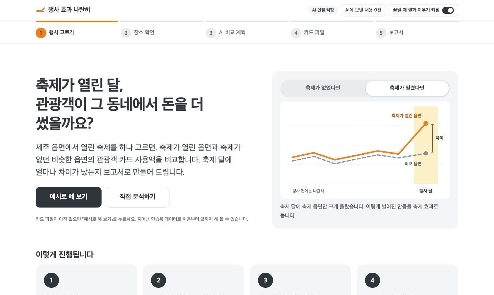
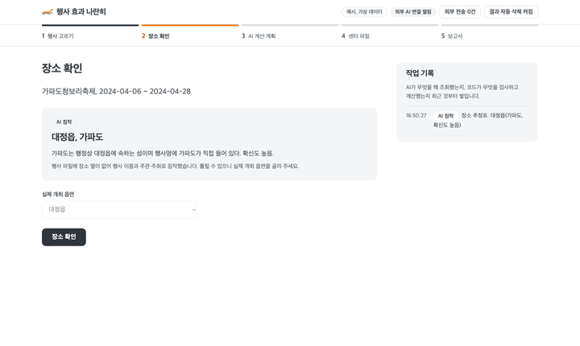
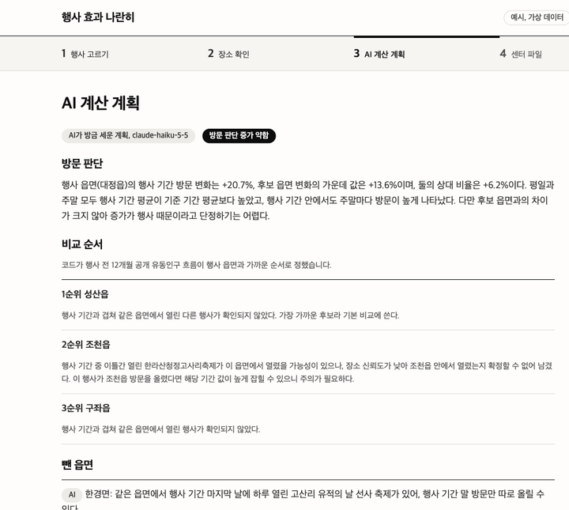
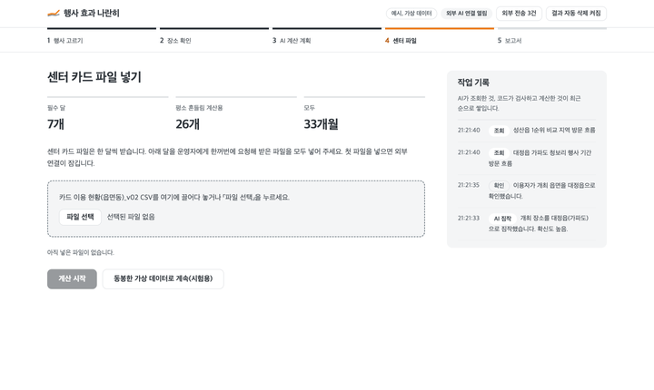
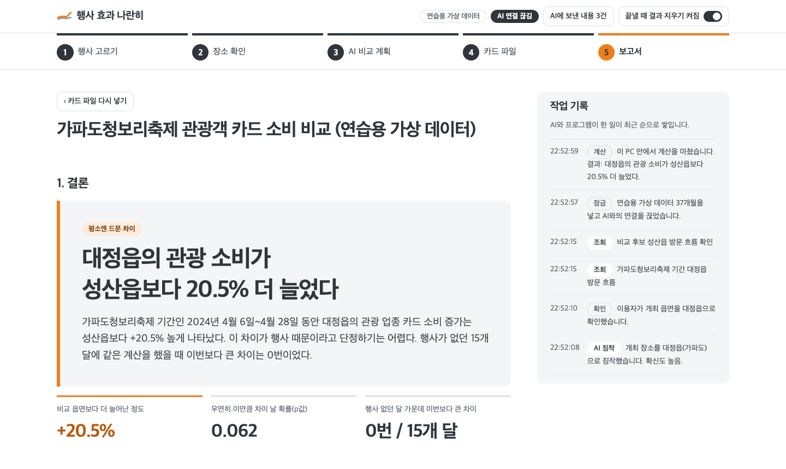
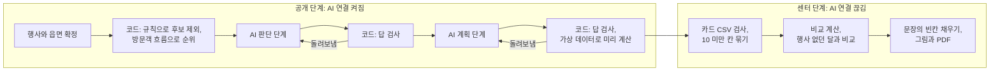

# 행사 효과 나란히

축제가 열린 달에 관광객이 그 읍면에서 돈을 더 썼는지, 축제가 없던 비슷한 읍면과 견주어 계산하는 AI Agent입니다. 「제주 AI·빅데이터 활용 AI Agent 개발 챌린지」 출품작입니다.



## 기획한 배경

읍면 축제를 맡은 담당자는 결과보고서와 다음 해 예산 자료에 "축제가 지역 소비를 얼마나 늘렸는지"를 적어야 합니다. 그 답은 제주빅데이터센터의 카드 데이터에 들어 있습니다. 그런데 꺼내 쓰기가 어렵습니다.

첫째로 비교가 어렵습니다. 흔히 작년 같은 달과 비교하는데, 그러면 계절, 요일, 제주 전체 관광 경기가 축제 효과와 섞입니다. 매년 열리는 축제는 작년에도 열렸으니 효과가 있어도 차이가 0 근처로 나옵니다.

둘째로 센터 안에서는 AI의 도움을 받기 어렵습니다. 센터 카드 데이터는 값을 외부 AI로 보낼 수 없습니다. 센터 이용자는 대부분 분석 전문가가 아닌데, 어떤 달을 받아 무엇과 비교해야 하는지를 혼자 정해야 합니다. 조회는 한 번에 한 달씩이라 무엇을 받을지 미리 알아야 방문 시간을 아낍니다.

셋째로 결과를 들고 나오려면 반출 심사를 통과해야 합니다. 원래 금액이나 건수가 들어 있거나 10 미만인 값이 남아 있으면 반출할 수 없습니다.

그래서 AI와 코드의 일을 나눴습니다. AI는 누구나 볼 수 있는 공개 자료만 보고 "무엇과 어떻게 비교할지"를 정합니다. 센터 데이터를 만지는 계산은 그 PC 안에서 코드만 합니다. 결과물은 처음부터 반출 기준에 맞춰 만듭니다.

## 무엇을 하나

축제 읍면과 평소 방문객 흐름이 비슷했던 읍면을 골라 두 곳을 나란히 놓습니다. 행사 직전 3개월 대비 증가율을 두 읍면에서 똑같이 계산하고, 벌어진 만큼을 보여 줍니다. 그 차이가 평소에도 생기는 크기인지는 행사가 없던 달들에 같은 계산을 해서 확인합니다.


위 화면은 예시 행사인 가파도청보리축제를 가상 데이터로 계산한 결과입니다. 실제 센터 카드 데이터는 제주빅데이터센터 안에서만 쓸 수 있어 이 저장소에 없습니다.


주황 실선이 축제 읍면, 회색 점선이 비교 읍면, 노란 띠가 행사 달입니다.

## 사용 흐름

화면은 다섯 단계이고, 각 화면 맨 위 왼쪽 버튼으로 앞 단계로 돌아갈 수 있습니다.

**1. 행사 고르기.** 「직접 분석하기」를 누르면 행사 목록이 나옵니다. 행사마다 계산할 수 있는지와 안 되는 이유가 표시됩니다. 카드 파일이 없으면 「예시로 해 보기」로 연습용 가상 데이터를 써서 끝까지 해 볼 수 있습니다.

**2. 장소 확인.** 행사 목록에는 장소가 적혀 있지 않습니다. AI가 행사 이름으로 짐작해 둔 읍면을 보여 주고, 사람이 실제로 열린 읍면을 고릅니다.



**3. AI 비교 계획.** AI가 30초~1분 동안 공개 방문객 통계를 조회하며 계획을 세웁니다. 행사 때 방문객이 늘었는지, 어느 읍면과 비교할지, 어느 읍면을 왜 뺐는지, 어떤 업종을 볼지가 나옵니다. 오른쪽 작업 기록에는 AI가 조회한 것과 코드가 검사한 것이 쌓입니다.



**4. 카드 파일.** 어느 달의 파일이 필요한지 알려 줍니다. 센터 운영자에게 그 기간을 요청해 받은 CSV를 끌어다 놓습니다. 첫 파일을 넣는 순간 AI와의 연결이 끊깁니다.



**5. 보고서.** 결론, 상황, 과제, 방법, 결과, 한계 순서로 나옵니다. 같은 내용의 PDF와 반출 신청서에 쓸 활용 사유 문장도 함께 만듭니다. 「끝내기」를 누르면 작업 기록과 결과를 지우고 처음으로 돌아갑니다.



## 에이전트 구조

AI가 일하는 구간과 코드만 일하는 구간이 잠금으로 나뉩니다. 잠금은 첫 카드 파일을 받기 직전에 걸리고 「끝내기」 전에는 풀리지 않습니다.



AI 단계는 둘입니다.

- **판단 단계.** 코드가 행사 정보, 방문객 요약값, 비교 후보 순위, 같은 시기의 다른 행사 목록을 줍니다. AI는 조회 도구로 방문객 흐름을 직접 확인한 뒤, 방문객이 늘었는지와 그 근거, 남길 후보와 뺄 후보, 각각의 이유를 제출합니다.
- **계획 단계.** 코드가 판단 결과와 업종 묶음 4개를 줍니다. AI는 행사 성격에 맞는 묶음 하나와 이유, 경우별 결과 문장 틀 4개, 방법 설명 문단, 이 행사만의 한계를 제출합니다.

코드는 제출을 받을 때마다 검사합니다. 통과하지 못하면 이유를 붙여 돌려보내고, AI는 단계마다 세 번까지 제출할 수 있습니다. 검사하는 것은 이렇습니다.

- AI가 쓴 글의 숫자가 입력이나 조회 결과에 실제로 있는지 대조합니다. 날짜, 순위, 개수까지 봅니다.
- "급증", "크게" 같은 크기 표현과 인과를 단정하는 표현은 돌려보냅니다.
- 결과 숫자가 들어갈 자리는 빈칸으로 써야 합니다. 계산 뒤에 코드가 채웁니다.
- 남은 비교 후보가 2곳보다 적으면 계산하지 않습니다.
- 계획 전체를 다른 난수로 만든 가상 데이터로 끝까지 돌려 본 뒤에만 받습니다.

AI에 연결하지 못하거나 세 번 안에 통과하지 못하면 미리 만든 계획을 씁니다. 계산할 수 있는 읍면 행사 26개에 준비해 두었고, 고른 읍면이 같을 때만 씁니다.

밖으로 나가는 요청은 `app/egress.py` 한 곳만 지나갑니다. 실행 1회에 호출은 16번까지, 한 호출은 65초까지로 막아 두었고, 보낸 본문은 모두 기록에 남습니다.

| 파일 | 맡은 일 |
|---|---|
| `app/server.py` | 화면과 단계 진행(FastAPI, 127.0.0.1에서만 열림) |
| `app/agent.py` | AI 두 단계, 도구 호출 처리, 제출 검사 |
| `app/grounding.py` | AI가 쓴 숫자를 입력과 대조 |
| `app/egress.py` | 외부 호출 한 곳, 잠금, 호출 상한, 전송 기록 |
| `app/pipeline.py` | 공개 단계와 센터 단계를 잇는 순서 |
| `app/card.py`, `app/calc.py` | 카드 CSV 검사와 10 미만 처리, 비교 계산 |
| `app/report.py` | 결과 문장, 그림, PDF, 활용 사유 |
| `app/prompts/` | AI 지시문과 도구 정의 |

## AI가 쓰는 도구

도구는 넷이고 정의는 `app/prompts/tools.json`에 있습니다. AI는 정해진 모양으로만 답할 수 있고, 자유로운 글로는 제출할 수 없습니다.

| 도구 | 언제 | AI가 넘기는 것 | 코드가 하는 일 |
|---|---|---|---|
| `get_visit_series` | 판단 단계에서 직접 확인하고 싶을 때 | 읍면, 시작일, 끝일, 왜 보는지 | PC에 동봉한 공개 유동인구에서 날짜별 방문 인구와 요일을 돌려준다. 한 번에 120일까지, 판단 단계에서 4번까지 |
| `submit_judgement` | 판단 단계의 끝 | 방문 판단과 이유, 남길 후보와 각 이유, 추가로 뺄 후보와 이유 | 후보가 빠짐없이 한 번씩 들어갔는지, 숫자에 근거가 있는지 검사한다 |
| `submit_plan` | 계획 단계의 끝 | 업종 묶음과 이유, 결과 문장 틀 4개, 방법 문단, 이 행사만의 한계 | 필수 빈칸, 금지 표현, 숫자 근거를 검사하고 가상 데이터로 미리 계산한다 |
| `submit_place_table` | 개발할 때 한 번 | 행사마다 짐작한 개최 읍면과 확신도 | 장소 추정표로 저장한다. 실행 중에는 부르지 않는다 |

`get_visit_series`를 부를 때마다 AI는 왜 보는지를 함께 적어야 하고, 그 이유가 작업 기록에 그대로 남습니다. 조회 도구가 읽는 것은 공개 데이터뿐입니다. 센터 카드 데이터를 읽는 도구는 없습니다.

## AI가 하는 일과 하지 않는 일

AI는 계획만 세웁니다. 센터 카드 데이터는 AI가 보지 않습니다. 값도, 행 수도, 집계도 밖으로 나가지 않습니다. 보고서의 숫자는 모두 코드가 계산합니다.

AI에게 보낸 내용은 화면 위쪽 「AI에 보낸 내용」에서 본문 그대로 볼 수 있습니다. 같은 창의 「자가 점검」을 누르면 표시값을 심은 가상 파일로 끝까지 돌려, 잠근 뒤 밖으로 나간 요청이 없는지를 포함해 일곱 가지를 프로그램이 직접 확인합니다.

## 검증

- 자동 시험 77개가 통과합니다.
- 윈도우에서 압축을 풀어 설치하고 끝까지 돌리는 시험을 GitHub Actions로 돌립니다. 한글과 공백이 든 경로를 포함해 두 경로 모두 통과합니다.
- AI 계획 단계는 시험 행사 5개를 3회씩 돌려 15회 중 13회가 끝까지 세워졌습니다. 실패 2회는 네트워크 오류였습니다. 실행 1회는 약 40초, 0.01달러쯤 듭니다.
- 효과를 심은 가상 데이터에서는 6개 조합 모두 "더 늘었다"가 나왔고, 심지 않은 데이터에서는 6개 중 1개가 잘못 나왔습니다.
- AI의 장소 짐작은 무작위로 뽑아 확인한 25건 가운데 20건이 맞았습니다. 틀린 짐작은 장소 확인 화면에서 사람이 고칩니다.

측정 방법과 한계는 [결과 설명자료](docs/result_ko.pdf)에 있습니다.

## 실행

**센터 PC(윈도우).** 제출용 묶음에 Python과 패키지가 모두 들어 있습니다. 압축을 풀고 `install.bat`, `run.bat` 순서로 실행합니다. 자세한 순서는 [사용자 매뉴얼](docs/manual_ko.pdf)에 있습니다.

**소스에서(개발용).** Python 3.11에서 아래처럼 실행합니다. AI 계획을 쓰려면 환경변수 `ANTHROPIC_API_KEY`가 필요합니다. 없으면 미리 만든 계획이 있는 행사 26개만 동작합니다.

```
cd app
python -m venv .venv && .venv/bin/pip install -r requirements.in
.venv/bin/python tools/make_dummy_card.py      # 연습용 가상 카드 데이터
.venv/bin/python -X utf8 server.py             # http://127.0.0.1:18501
.venv/bin/python -m unittest discover -s tests # 자동 시험
```

브라우저가 열리면 「예시로 해 보기」를 누릅니다. 카드 파일 없이 처음부터 끝까지 해 볼 수 있습니다.

## 문서

- [기획서](docs/proposal/proposal.pdf)
- [사용자 매뉴얼](docs/manual_ko.pdf)
- [데이터 활용 명세](docs/data_spec_ko.pdf)
- [결과 설명자료](docs/result_ko.pdf)

## 폴더

| 폴더 | 내용 |
|---|---|
| `app/` | 프로그램(서버, 계산, AI 단계, 화면), 지시문, 자동 시험, 묶음 만드는 도구 |
| `app/data/` | 동봉한 공개 자료(제주데이터허브 유동인구와 주요행사정보), 미리 만든 계획 |
| `.github/` | 윈도우에서 묶음을 풀어 설치부터 자가 점검까지 돌리는 자동 시험 |
| `docs/` | 기획서, 매뉴얼, 데이터 명세, 결과 설명자료, 시연 영상과 캡처 스크립트 |
| `qa/` | AI 단계 측정 기록, 장소 추정표 정답표 |
| `team-reports/` | 주제와 설계를 정할 때 쓴 기획 문서 |

## 쓴 것

- AI 모델은 Anthropic Claude Haiku 5.5이고, 계획 단계에서만 부릅니다. 개발에는 Claude Code를 썼습니다.
- 공개 데이터는 제주데이터허브의 읍면동 단위 내국인 유동인구와 제주특별자치도 주요행사정보입니다.
- 센터 데이터는 제주빅데이터센터의 카드 이용 현황(읍면동)_v02입니다. 개발과 시험에는 센터 명세서 구조를 따른 가상 데이터만 썼습니다.
- 주요 오픈소스는 FastAPI, uvicorn, matplotlib, fpdf2입니다. 전체 목록과 라이선스는 기획서 마지막 쪽에 있습니다.

## 한계

- 읍면 12곳의 행사만 다룹니다. 동 지역은 카드 데이터와 유동인구의 지역 구분이 달라 맞출 수 없습니다.
- 카드 데이터가 월 단위라 1~3일짜리 행사는 한 달 합계에 묻혀 계산하지 않습니다.
- 결과는 비교 읍면 대비 차이입니다. 축제가 소비를 늘렸다는 인과를 증명하지는 않습니다.
- 검증은 가상 데이터로만 했습니다. 실제 카드 데이터에서는 효과 크기와 계산할 수 없는 비율이 다를 수 있습니다.
