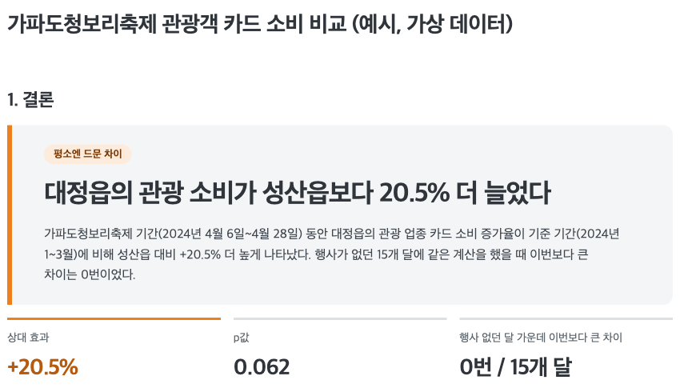
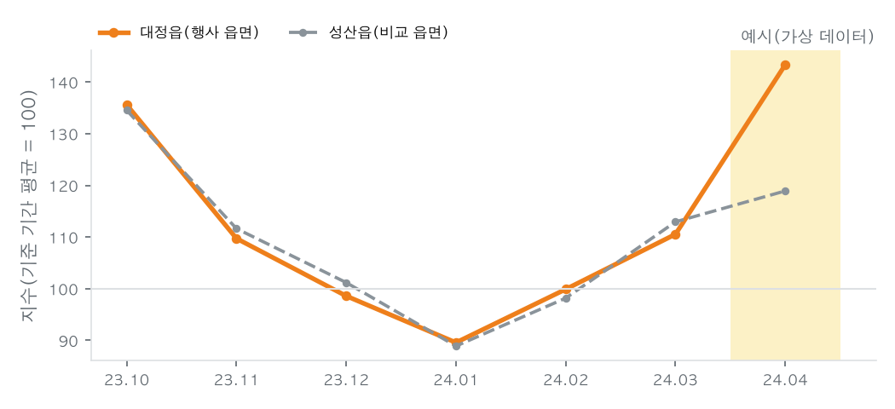

# 행사 효과 나란히

축제가 열린 달에 관광객이 그 읍면에서 돈을 더 썼는지, 축제가 없던 비슷한 읍면과 견주어 계산하는 AI Agent입니다. 「제주 AI·빅데이터 활용 AI Agent 개발 챌린지」 출품작입니다.


## 무엇을 하나

읍면 축제를 맡은 담당자는 결과보고서에 "축제가 지역 소비를 얼마나 늘렸는지"를 적어야 합니다. 흔히 작년 같은 달과 비교하는데, 그러면 계절, 요일, 제주 전체 관광 경기가 축제 효과와 섞입니다.

이 프로그램은 축제 읍면과 평소 방문객 흐름이 비슷했던 읍면을 골라 두 곳을 나란히 놓습니다. 행사 직전 3개월 대비 증가율을 두 읍면에서 똑같이 계산하고, 벌어진 만큼을 보여 줍니다. 그 차이가 평소에도 생기는 크기인지는 행사가 없던 달들에 같은 계산을 해서 확인합니다.



위 화면은 예시 행사인 가파도청보리축제를 가상 데이터로 계산한 결과입니다. 실제 센터 카드 데이터는 제주빅데이터센터 안에서만 쓸 수 있어 이 저장소에 없습니다.

## 어떻게 동작하나

1. 행사를 고르고 실제로 열린 읍면을 확인합니다.
2. AI(Claude Haiku 5.5)가 공개 방문객 통계와 행사 목록을 보고 비교 계획을 세웁니다. 코드가 AI의 답을 검사하고, 가상 데이터로 미리 돌려 본 뒤에 받습니다.
3. 센터 카드 CSV를 넣는 순간 외부 연결이 끊기고, 계산은 그 PC 안에서 코드가 합니다.
4. 결론부터 쓰는 보고서 PDF, 그림 2장, 반출 신청서에 쓸 활용 사유가 나옵니다.



주황 실선이 축제 읍면, 회색 점선이 비교 읍면, 노란 띠가 행사 달입니다.

## AI가 하는 일과 하지 않는 일

AI는 계획만 세웁니다. 행사 기간에 방문객이 늘었는지 판단하고, 같은 시기에 다른 축제가 열려 비교를 흐릴 읍면을 빼고, 행사 성격에 맞는 업종 묶음을 고릅니다.

센터 카드 데이터는 AI가 보지 않습니다. 값도, 행 수도, 집계도 밖으로 나가지 않습니다. 보고서의 숫자는 모두 코드가 계산하고, AI가 쓴 문장에는 숫자 자리에 빈칸만 있어 코드가 채웁니다. AI가 쓴 글에 근거 없는 숫자가 있으면 코드가 돌려보냅니다.

AI에게 보낸 내용은 화면 위쪽 「AI에 보낸 내용」에서 본문 그대로 볼 수 있습니다.

## 검증

- 자동 시험 77개가 통과합니다.
- 윈도우에서 압축을 풀어 설치하고 끝까지 돌리는 시험을 GitHub Actions로 돌립니다. 한글과 공백이 든 경로를 포함해 두 경로 모두 통과합니다.
- AI 계획 단계는 시험 행사 5개를 3회씩 돌려 15회 중 13회가 끝까지 세워졌습니다. 실패 2회는 네트워크 오류였습니다. 실행 1회는 약 40초, 0.01달러쯤 듭니다.
- 효과를 심은 가상 데이터에서는 6개 조합 모두 "더 늘었다"가 나왔고, 심지 않은 데이터에서는 6개 중 1개가 잘못 나왔습니다.
- AI의 장소 짐작은 무작위로 뽑아 확인한 25건 가운데 20건이 맞았습니다. 틀린 짐작은 장소 확인 화면에서 사람이 고칩니다.

측정 방법과 한계는 [결과 설명자료](docs/result_ko.pdf)에 있습니다.

## 실행

**센터 PC(윈도우).** 제출용 묶음에 Python과 패키지가 모두 들어 있습니다. 압축을 풀고 `install.bat`, `run.bat` 순서로 실행합니다. 자세한 순서는 [사용자 매뉴얼](docs/manual_ko.pdf)에 있습니다.

**소스에서(개발용).** Python 3.11에서 아래처럼 실행합니다. AI 계획을 쓰려면 환경변수 `ANTHROPIC_API_KEY`가 필요합니다. 없으면 미리 만든 계획이 있는 행사 26개만 동작합니다.

```
cd app
python -m venv .venv && .venv/bin/pip install -r requirements.in
.venv/bin/python tools/make_dummy_card.py      # 연습용 가상 카드 데이터
.venv/bin/python -X utf8 server.py             # http://127.0.0.1:18501
.venv/bin/python -m unittest discover -s tests # 자동 시험
```

브라우저가 열리면 「예시로 해 보기」를 누릅니다. 카드 파일 없이 처음부터 끝까지 해 볼 수 있습니다.

## 문서

- [기획서](docs/proposal/proposal.pdf)
- [사용자 매뉴얼](docs/manual_ko.pdf)
- [데이터 활용 명세](docs/data_spec_ko.pdf)
- [결과 설명자료](docs/result_ko.pdf)

## 폴더

| 폴더 | 내용 |
|---|---|
| `app/` | 프로그램(서버, 계산, AI 단계, 화면), 지시문, 자동 시험, 묶음 만드는 도구 |
| `app/data/` | 동봉한 공개 자료(제주데이터허브 유동인구와 주요행사정보), 미리 만든 계획 |
| `.github/` | 윈도우에서 묶음을 풀어 설치부터 자가 점검까지 돌리는 자동 시험 |
| `docs/` | 기획서, 매뉴얼, 데이터 명세, 결과 설명자료, 시연 영상과 캡처 스크립트 |
| `qa/` | AI 단계 측정 기록, 장소 추정표 정답표 |
| `team-reports/` | 주제와 설계를 정할 때 쓴 기획 문서 |

## 쓴 것

- AI 모델은 Anthropic Claude Haiku 5.5이고, 계획 단계에서만 부릅니다. 개발에는 Claude Code를 썼습니다.
- 공개 데이터는 제주데이터허브의 읍면동 단위 내국인 유동인구와 제주특별자치도 주요행사정보입니다.
- 센터 데이터는 제주빅데이터센터의 카드 이용 현황(읍면동)_v02입니다. 개발과 시험에는 센터 명세서 구조를 따른 가상 데이터만 썼습니다.
- 주요 오픈소스는 FastAPI, uvicorn, matplotlib, fpdf2입니다. 전체 목록과 라이선스는 기획서 마지막 쪽에 있습니다.

## 한계

- 읍면 12곳의 행사만 다룹니다. 동 지역은 카드 데이터와 유동인구의 지역 구분이 달라 맞출 수 없습니다.
- 카드 데이터가 월 단위라 1~3일짜리 행사는 한 달 합계에 묻혀 계산하지 않습니다.
- 결과는 비교 읍면 대비 차이입니다. 축제가 소비를 늘렸다는 인과를 증명하지는 않습니다.
- 검증은 가상 데이터로만 했습니다. 실제 카드 데이터에서는 효과 크기와 계산할 수 없는 비율이 다를 수 있습니다.
